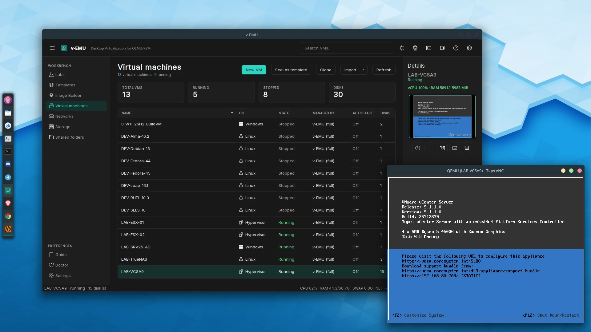

# v-EMU

**A local-first virtualization lab for Linux — templates, linked clones and
declarative labs on the KVM stack you already trust.**



v-EMU is a desktop application for repeatable, self-contained labs on one Linux
host. It drives QEMU/KVM and libvirt directly: no second hypervisor, no web
console, no control plane, and no cluster to babysit. Templates, storage,
networks, consoles and lab definitions live in one place, with a CLI for the
same operations.

> **Status:** 0.2.0 release. A thin `.run` installer is built from the same
> tag and published on GitHub Releases.

## Why v-EMU

### The lab is the unit

Most tools stop at "create a VM". v-EMU is built around a **seal → clone → lab**
cycle: prepare a template once, spin up linked clones, and describe the whole
lab in `lab.yaml`. `vemu up`, `vemu status` and `vemu down` work on the lab, not
on a pile of individual domains. Lab bundles can be exported and imported as
one file.

### Storage without mystery layers

Every VM has a visible qcow2 chain with v2 metadata. Snapshots are offline
layers you can see, revert and delete; templates stay immutable; deletion is
reference-checked and only managed files are removed. Orphan layers show up in
**Clean garbage** or `vemu gc`, not as silent disk usage. Storage roles keep
`labs`, `templates` and `isos` separate.

### Networks included

NAT, isolated and LAN-bridge profiles are defined in the app, applied through
libvirt and nftables, and visible in the network map. DHCP reservations, port
forwards, multiple NICs and link control are part of the same workflow — no
hand-written XML required.

### Desktop-first, CLI-complete

The PySide6 shell is a real desktop app: one UI instance per user, embedded
noVNC consoles, a mini console in the inspector, and non-modal dialogs for
everyday work. Modal prompts are reserved for destructive confirmations and
errors. Every important operation is also available through `vemu`, so the UI
and scripts use the same engine.

### Adopt existing VMs, gradually

Already running VMs in libvirt, Cockpit or virt-manager? They stay **External
and read-only by default**. When you are ready, adopt the XML while keeping the
disks in place, or run a full migration that rebuilds the disk as a v-EMU chain
and keeps the old disks until you are satisfied. See
[`MANUAL.md`](MANUAL.md) → **Import / adopt / migrate**.

### Small scope, honest limits

v-EMU is one host, one user, local VMs. It deliberately does not ship clustering,
HA, live migration, a web console or GPU passthrough. Guest clipboard and
VirtioFS have explicit guest-side requirements, documented with tested guests
and failure messages. What remains is a tool that does local labs well instead
of pretending to be a cloud.

## Requirements

- 64-bit Linux with KVM: Intel VT-x (`vmx`) or AMD-V (`svm`), `/dev/kvm`.
- Python 3.11 or newer on the host.
- `sudo` for host packages, the daemon, groups and firmware.
- A Wayland desktop for the UI (KDE Plasma, GNOME and COSMIC tested).
- 20 GiB free for labs plus VM images.

There is no TCG-only host mode; cross-architecture TCG is optional for guests.

## Host coverage and feature parity

| Capability | RHEL family | openSUSE | Debian/Ubuntu |
|---|---|---|---|
| Core v-EMU: lifecycle, snapshots, storage, networking, VNC | supported | supported | supported |
| External TigerVNC console | supported* | supported* | supported* |
| Image Builder (qcow2/ISO) | supported | unavailable | unavailable |
| Arch family | experimental `contrib/setup-arch.sh`, core only | — | — |

\* Install `tigervnc` (Fedora/RHEL/openSUSE) or `tigervnc-viewer`
(Debian/Ubuntu); external mode stays disabled when `vncviewer` is missing.

The host matrix covers all three Linux families for core vEMU. **Image Builder
is intentionally limited to Fedora/RHEL-family hosts in 0.2.0**: Debian and
openSUSE keep the full core feature set but the Image Builder page shows an
unsupported-host banner and hides new builds. This is a documented feature gap,
not a regression in VM lifecycle or console support.

## Install

From source:

```bash
git clone https://github.com/withcoresystem/v-EMU vEMU
cd vEMU
./setup.sh --precheck
./setup.sh --standard
```

Run as your normal desktop user, not with `sudo`. `--full` adds optional
aarch64/riscv64 TCG packages where the distribution provides them. After first
install, reboot or log out/in so group membership applies.

Or download `vemu-0.2.0-x86_64.run` from
[GitHub Releases](https://github.com/withcoresystem/v-EMU/releases/latest),
verify it with the adjacent `.sha256`, then run it. The `.run` uses the same
setup logic and keeps its extracted source under `~/.local/share/vemu/source`;
`--uninstall` removes it.

Full install, first-run, adoption, support matrix and uninstall:
[`MANUAL.md`](MANUAL.md).

## Quick start

```bash
vemu --version
vemu doctor
vemu ui
```

Create lab storage and a NAT network from the first-run wizard, or from
**Storage** and **Networks**. Then use **Virtual machines → New VM**.

## Documentation

| Document | Contents |
|---|---|
| [`MANUAL.md`](MANUAL.md) | Install, daily use, adoption, networking, storage, security, CLI |
| [`BUILDER.md`](BUILDER.md) | Image Builder qcow2/ISO flow, blueprints, firstboot payloads |
| [`docs/BUILDER-BRANDING.md`](docs/BUILDER-BRANDING.md) | Installer ISO branding and asset standards |
| [`docs/ARCHITECTURE.md`](docs/ARCHITECTURE.md) | Implemented 0.2.0 process and trust boundaries |
| [`GRAPHICS.md`](GRAPHICS.md) | Video models, sleep/resume and guest trade-offs |
| [`docs/USER-GUIDE.md`](docs/USER-GUIDE.md) | Concise in-app guide |
| [`docs/ARCH-EXPERIMENTAL.md`](docs/ARCH-EXPERIMENTAL.md) | Arch/CachyOS/Omarchy experimental core-only installer |
| [`docs/RELEASING.md`](docs/RELEASING.md) | Public `.run` build, clean-host test and GitHub release process |
| [`docs/release-notes/v0.2.0.md`](docs/release-notes/v0.2.0.md) | Release notes for 0.2.0 |
| [`CONTRIBUTING.md`](CONTRIBUTING.md) | Issues, pull requests and scope |
| [`SECURITY.md`](SECURITY.md) | Vulnerability reporting and trust model |
| [`DISCLAIMER.md`](DISCLAIMER.md) | Warranty, data/backup and liability terms |

Experimental helpers live in the source tree: [`templates/`](templates/) has the
full blueprint set, [`contrib/setup-arch.sh`](contrib/setup-arch.sh) installs the
Arch-family core, and [`contrib/windows/README.md`](contrib/windows/README.md)
documents the standalone Windows guest optimization helper. These are not part
of the `.run` payload and are not supported features.

## Roadmap

The roadmap is directional, not a release promise.

### 0.3.0 (planned)

- **Bug fixes and reliability** — regressions, host compatibility and
  documentation fixes reported against 0.2.0.
- **Windows guest seamless mode** — optional helper to prepare a Windows 10/11
  Pro/Enterprise guest for RemoteApp and open individual applications as Linux
  windows. The full desktop remains the fallback; QXL/VGA stays the default.
  This is the only committed Windows guest graphics path for 0.3.0.
- **Storage compaction** — merge or discard old snapshot layers and reclaim
  disk space without recreating the VM.

**Windows 3D acceleration is not a 0.3.0 commitment.** It remains a private lab
experiment; a post-0.2.0 driver spike will decide whether any preview is opened.
It is not support for PCIe/VFIO passthrough or commercial vGPU.

Image Builder host coverage is unchanged in 0.3.0: Fedora/RHEL-family only.

## Non-goals

- multi-host cluster, scheduler, HA or live migration;
- remote/web multi-user operation or a remote thick client;
- 3D acceleration as a supported feature, or GPU/PCIe passthrough; a Windows 3D
  lab experiment may be evaluated separately but is not a release commitment;
- macOS guests;
- live snapshots (snapshots are offline, chain-based);
- X11 guest clipboard/integration;
- container management or orchestration (Docker, Podman, Kubernetes);
- a general-purpose replacement for Proxmox/oVirt/Incus.

## License

GPL-3.0-or-later. See [`LICENSE`](LICENSE). v-EMU is provided without
warranty; data, backup and liability terms are in [`DISCLAIMER.md`](DISCLAIMER.md).
Firmware and bundled assets have their own notices in [`NOTICE`](NOTICE) and
`firmware/`.
